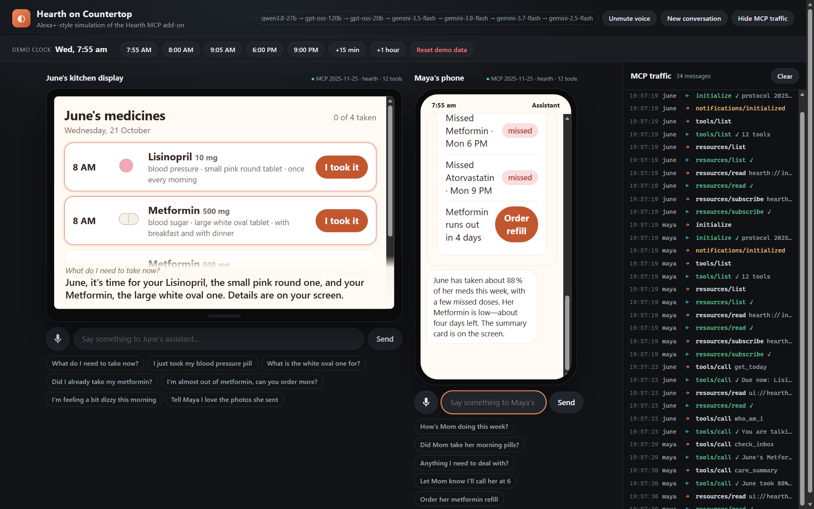
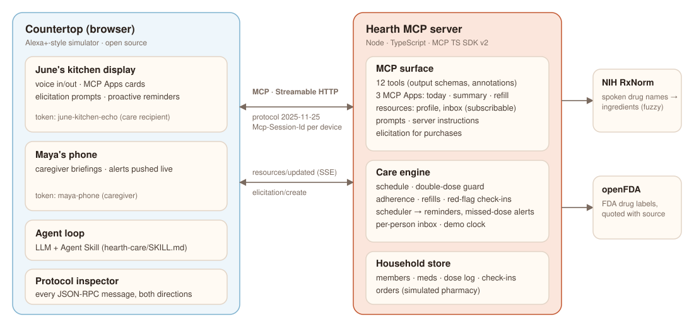

# Hearth — an Alexa+ care companion for families

**Hearth** is an Alexa+ add-on, built as a self-hosted **MCP server (spec 2025-11-25, Streamable HTTP)**, for the
family members who look out for an older parent. The parent talks to it on a kitchen display: *"What do I take
now?"*, *"I took my morning pills"*, *"What's the white oval one for?"*. A daughter or son asks from their phone:
*"How's Mom doing this week?"* Both people talk to the **same MCP server**, so the context carries across devices,
people and days.

**Countertop**, in this repo, is an open-source, browser-based **Alexa+-style simulator for any MCP server**: a real
MCP client with voice in and out, an MCP Apps host, elicitation, resource subscriptions and a live protocol
inspector. It exists because the Alexa+ developer tools are still in private preview.

> Hackathon: *Build, Ship, Shape — Amazon Developer Hackathon 2026* · Track: **Alexa+** · Mini challenge: **Open Source**



## Why

- About 53 million Americans are unpaid family caregivers (AARP, *Caregiving in the U.S.* 2020), most of them caring
  for an aging parent or relative. Much of that care is remote and repetitive: did Mom take her pills, is she
  running low, how has she been feeling?
- Medication non-adherence is one of the most common and most preventable problems in older adults.
- Amazon retired *Alexa Together* in 2024, and nothing has replaced it.

Alexa+ is already in the kitchen, and it is voice-first, which is how many older adults prefer to use technology.
Hearth puts the care circle in Alexa+.

## What it does

| | June (79, kitchen display) | Maya (her daughter, phone) |
|---|---|---|
| **Reminders** | Hears *"It's 8 AM, June — time for your Lisinopril, the small pink round one…"* the moment a dose is due (pushed via MCP resource subscription) | Gets an alert if a dose is still not taken an hour later |
| **Logging** | *"I took my morning pills"* logs every due dose. *"Did I take the pink one?"* → *"Yes, at 8:04. Don't take another."* (double-dose protection) | Sees exactly what was taken, when, and by whom |
| **Medication facts** | *"What's the white oval one for?"* → answered from the **FDA drug label** (openFDA), attributed, never dosing advice | Same, for any medication |
| **Refills** | *"I'm almost out of metformin"* → price and delivery are confirmed on the device (**MCP elicitation**) before anything is ordered | Notified when an order is placed; can order on June's behalf |
| **Wellbeing** | *"I fell getting out of my chair, but I'm okay"* is logged, and the family is alerted at once | Phone announces it immediately and offers to send a message |
| **Weekly picture** | — | *"How's Mom doing?"* → adherence, missed doses, mood trend and refills on an **MCP Apps** card |
| **Adding meds** | Spoken drug names are normalised with **NIH RxNorm** (speech recognition turns *metformin* into *"met for men"*) | Same |

## Architecture



- **`packages/hearth-server`**: the MCP server. TypeScript, MCP TypeScript SDK v2, stateful Streamable HTTP
  sessions on `/mcp`, protocol **2025-11-25**.
  - **12 tools**, all with output schemas and structured content, plus annotations.
  - **Resources**: a household profile, and a **subscribable inbox** that sends `notifications/resources/updated`
    to drive proactive reminders and alerts.
  - **2 prompts** and server `instructions`.
  - **3 MCP Apps** views (`ui://hearth/today.html`, `summary.html`, `refill.html`).
  - Refills are confirmed through **elicitation**. If the client lacks elicitation, the server falls back to a
    two-step `confirm_refill`.
  - Each device's bearer token identifies the person (in real Alexa+ terms, the recognised speaker). One server
    instance per session is bound to that person.
  - A demo clock (`/demo/*`) lets a presenter jump to 8 AM, an hour later, and so on.
- **`packages/countertop`**: the simulator. Vite and TypeScript in the browser.
  - The browser *is* the MCP client: `initialize`, `tools/list`, `tools/call`, `resources/subscribe` and so on,
    over Streamable HTTP.
  - A small Node server proxies the LLM, so API keys never reach the page.
  - The assistant's instructions are the **Agent Skill** in [`skills/hearth-care/SKILL.md`](skills/hearth-care/SKILL.md),
    loaded at runtime, together with the server's `instructions`.
- **`skills/hearth-care`**: an [Agent Skill](https://agentskills.io) that teaches any agent the Hearth workflows,
  voice rules and safety rules.

## Run it (about 2 minutes)

Requirements: Node.js 20+ and one free LLM key, for the simulator's assistant only.

```bash
git clone https://github.com/aditya13504/hearth.git
cd hearth
npm install
cp .env.example .env      # then add GROQ_API_KEY (free: console.groq.com/keys) and/or LLM_API_KEY (Gemini, free)
npm run dev
```

Open **http://localhost:5173** in **Edge or Chrome** (both support the Web Speech API).

- **Run the story** (right-hand panel): click **Play step 1, 2, 3…** and each step plays itself on the right device.
  This is the guided demo.
- **June's day** (the top band) moves the demo clock: *7:55 AM*, **8:00 AM** for the reminder, **9:05 AM** for the
  missed-dose alert on Maya's phone, and so on.
- To try it yourself, talk to either device with its mic button, type, or tap a suggestion chip.
- **Reset demo** in the top bar starts over.

| Service | URL |
|---|---|
| Hearth MCP server | `http://localhost:8787/mcp` (Streamable HTTP, protocol 2025-11-25) |
| Countertop simulator | `http://localhost:5173` |

Device tokens for the demo household: `june-kitchen-echo` (June, care recipient) and `maya-phone` (Maya, caregiver).

### Run Hearth for a real family (production mode)

`npm run dev` runs the **demo**: a fictional household, a movable clock and the `/demo` controls. To run Hearth for
real people, use production mode:

```bash
npm run setup -w hearth-server -- --household "Lee family" --recipient "Ruth:Mom" --caregiver "Sam:son"
HEARTH_MODE=production npm start -w hearth-server
```

- **Setup** creates the household and prints a random 256-bit device token for each person, once. Only SHA-256 hashes
  of the tokens are stored.
- **Medicines** are added by voice or from a caregiver's device ("Add lisinopril 10 mg every morning at 8, it's for
  blood pressure"). Each name is checked against RxNorm. Doses scheduled before a medicine was added never count as
  missed.
- **Production mode differences:** it uses the real clock and has no demo controls. It never regenerates or resets
  data, and saves are atomic, so a crash can't leave half a file. It refuses to start without a household, and it
  won't mix demo data with real data.
- **Browser access:** pages may call the server only from localhost by default. Set `HEARTH_ALLOWED_ORIGINS` to allow
  other origins.
- **What is still simulated:**
  - refill orders, until a pharmacy is connected
  - the Alexa+ device itself, since the Alexa+ developer tools are partner-only, so Countertop or any MCP client
    stands in

### Use Hearth from any MCP client

Hearth is a standard MCP server, so it is not tied to Countertop. Any client that supports Streamable HTTP and a
custom `Authorization` header can connect. The test suite verifies this with the official MCP TypeScript SDK client.
For example, to add it to Claude Code:

```bash
claude mcp add --transport http hearth http://localhost:8787/mcp --header "Authorization: Bearer maya-phone"
```

Then ask *"How's Mom doing this week?"*

### Tests

```bash
npm test
```

54 automated tests:

- **Unit tests** cover the care engine: fuzzy medication matching, double-dose protection, scheduling,
  missed-dose escalation, adherence, refills, and red-flag check-ins.
- **Countertop guardrail tests** check that replies claiming or announcing an action with no tool call are held back.
- **Production-mode tests** cover:
  - setup stores only token hashes
  - the family's tokens work and the demo tokens are rejected
  - there are no demo controls
  - real data is never regenerated
  - untrusted browser origins are refused
- **End-to-end protocol tests** run a real MCP client over Streamable HTTP and check:
  - that the client and server agree on protocol 2025-11-25
  - that unknown device tokens are rejected
  - MCP Apps metadata on the tools
  - `resources/updated` push notifications
  - refills confirmed through elicitation, both accept and decline
  - the two-step fallback for clients without elicitation

## Safety and privacy choices

- **No dosing advice.** Medication facts are quoted from the FDA label with source and date. The tools never suggest
  skipping, doubling or changing a dose.
- **Double-dose protection** is enforced on the server, not left to the model.
- **Nothing is purchased without explicit confirmation** on the device. A confirmation is only accepted from a short,
  clear "yes": *"I fell but I'm okay"* will never approve an order.
- **The assistant can't claim an action it didn't take.** Countertop sends a reply such as "I've told Maya" back to
  the model if no tool was called that turn.
- The pharmacy is **simulated** and clearly labelled. No real orders or payments are made. The people are fictional.

## Repository layout

```
packages/hearth-server   MCP server (care engine, tools, resources, prompts, MCP Apps views, tests)
packages/countertop      Voice assistant simulator for MCP servers (open source, MIT)
skills/hearth-care       Agent Skill used by the assistant
docs/                    Design spec, submission write-up, product feedback, friction log, media
```

## License

MIT. See [LICENSE](LICENSE).
